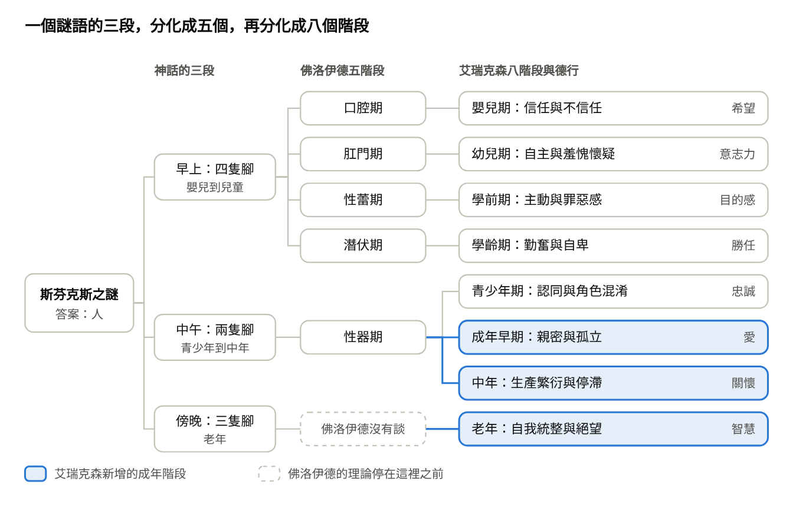
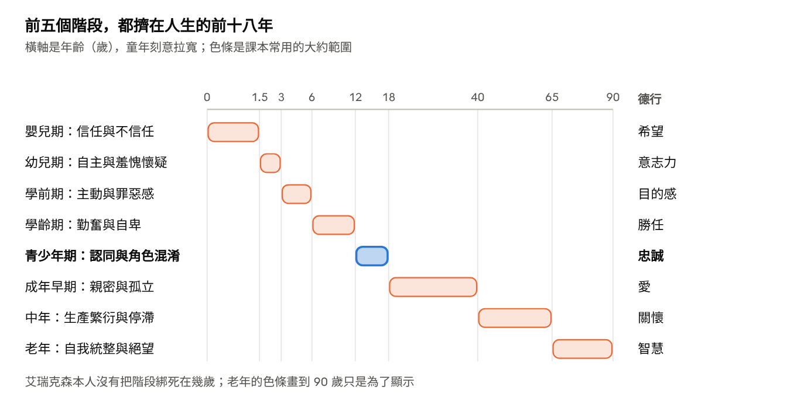

> [!quote] 故事
> （以下改寫自希臘神話。）
>
> 底比斯城外的山崖上，蹲著一隻獅身人面的怪物。
>
> 她攔下每一個經過的旅人，問同一個謎語：
>
> 「什麼東西早上用四隻腳走路，
>
> 中午用兩隻腳，
>
> 傍晚用三隻腳？」
>
> 答不出來的人，她就一口吃掉。
>
> 城裡的人一個接一個死去，沒有人敢出城。城裡的掌權者只好宣布：
>
> 誰能解開謎語，就把王位交給他。
>
> 一名從外地流浪來的年輕人，走上山崖。
>
> 他想一想，回答：
>
> 「是人。」
>
> 「人在生命的早晨是嬰兒，用手和膝蓋在地上爬；
>
> 中午長大成人，用兩條腿走路；
>
> 傍晚年老時，拄著拐杖，變成三隻腳。」
>
> 怪物聽完，從山崖上跳下去。
>
> 這名年輕人進城當上國王，他就是伊底帕斯。

## 謎語裡藏著一張人生地圖

斯芬克斯的謎語，把人的一生切成三段：爬行、行走和拄杖。

不過這三段只看身體怎麼移動，沒有問每一段的人心裡在煩惱什麼。

兩千多年後，精神分析師艾瑞克森（Erik Erikson）替人生重新畫一張地圖。

## 艾瑞克森把佛洛伊德的童年，延伸成一輩子

艾瑞克森切分一生成八段，每一段都有一個內心需要渡過的關卡，整個歷程稱為「心理社會發展階段」（psychosocial stages）。

伊底帕斯王答得出「人」，卻一直不知道自己是誰的兒子。

「我是誰？」這個問題，正好是艾瑞克森理論裡最有名的一關。

佛洛伊德把「早上」細分成四個童年階段，艾瑞克森再從性器期分出三個，並補上佛洛伊德沒談的老年。

艾瑞克森的八個階段，是他在 1950 年的《童年與社會》（Childhood and Society）中提出的理論，改寫自佛洛伊德的[[性心理發展階段]]。改動之處主要有 3 點：

### 1. 從身體的快感，改成人和社會的關係

佛洛伊德問的是：孩子在這個年紀，快感來自身體哪個部位？

艾瑞克森問的是：這個年紀的人，要學會和誰相處？社會對他有什麼期待？

### 2. 從本我，改成自我

佛洛伊德看的是[[精神分析 Psychoanalysis|本我和超我]]之間的拉扯。

艾瑞克森看的是自我（ego）如何成長，如何整合一個人的經驗，所以他屬於自我心理學（ego psychology）這一派。

### 3. 從青春期為止，延伸到老年

佛洛伊德認為人格大致在童年定型。

艾瑞克森認為人格一輩子都在發展，所以從青春期為止的發展階段理論，延伸至成年早期、中年、老年。

### 每個階段都是一個「危機」

艾瑞克森把每個階段的關卡叫做心理社會危機（psychosocial crisis）。

這裡的危機不是災難，而是轉捩點。

處於人生轉捩點的人，必須在岔路之間找到出路。

每個危機都由一組相反的力量組成，例如「信任對不信任」。

健康的結果不是完全只有信任，而是信任多於不信任。

帶一點懷疑的人，反而不會輕易上當。

如果能順利度過心理危機，就會萌生出心理力量，艾瑞克森稱為「德行」（virtue）。

### 人格就像胚胎，照時間表長出來

艾瑞克森用後成原則（epigenetic principle）解釋八個階段的順序。

這個詞借自胚胎學，指的是「胚胎的器官照固定的時間表接續成長，後來的器官建立在前面的基礎之上。」

艾瑞克森認為人格如同器官，每個階段有它最關鍵的時期，並且會影響之後任何階段的發展情形。

## 八個階段，八個人生問題

八個階段各自問一個問題，答得好，就長出一種德行。

艾瑞克森本人沒有把階段綁定在幾歲，下面的年齡是後來課本常用的大約範圍。

前五個階段只佔一生的前十八年，後面三個階段卻要走七十年。

前四個童年階段，和佛洛伊德、克萊恩、鮑比的童年分期放在一起，就是[[依附理論 Attachment Theory#四套發展理論，看的是同一段童年|四套發展理論的對照表]]。

### 嬰兒期：世界可以信任嗎？

- 危機：信任與不信任（trust vs. mistrust），約出生到一歲半。
- 問題：我需要的時候，會有人來嗎？
- 照顧者穩定地餵飽、安撫嬰兒，嬰兒就長出「希望」。
- 這個問題和[[依附理論 Attachment Theory|依附理論]]關心的是同一件事，也對應佛洛伊德的口腔期。照顧者穩不穩定，就是依附理論說的[[依附理論 Attachment Theory#照顧者的敏感度很重要，但不是唯一的條件|照顧者敏感度]]，也是溫尼考特說的[[客體關係理論 Object Relations Theory#Donald Winnicott：夠好的母親|夠好的母親]]。

### 幼兒期：我可以自己來嗎？

- 危機：自主與羞愧與懷疑（autonomy vs. shame and doubt），約一歲半到三歲。
- 問題：我能控制自己的身體、自己做決定嗎？
- 孩子學走路、學上廁所，開始很愛說「不要」。
- 大人讓孩子在安全範圍內自己試，孩子就長出「意志力」；大人一再嘲笑孩子的失敗，孩子就開始懷疑自己。
- 對應佛洛伊德的肛門期。

### 學前期：我可以主動去做嗎？

- 危機：主動與罪惡感（initiative vs. guilt），約三到六歲。
- 問題：我可以自己想點子、自己開始一件事嗎？
- 孩子發起遊戲、玩扮家家酒、問不完的「為什麼」。
- 大人支持孩子的主意，孩子就長出「目的感」；大人常常責罵孩子的主動，孩子就學會「想要就是錯」。
- 對應佛洛伊德的性蕾期，也就是[[伊底帕斯情結 Oedipus Complex|伊底帕斯情結]]出現的時期。

### 學齡期：我做得到嗎？

- 危機：勤奮與自卑（industry vs. inferiority），約六到十二歲。
- 問題：我學得會、做得好嗎？
- 孩子上學、學技能，開始和同學比較。
- 孩子如果一再完成事情，就能相信自己足以「勝任」其他挑戰；如果一再輸給別人，就覺得自己不如人，不願嘗試任何機會。
- 對應佛洛伊德的潛伏期。

### 青少年期：我是誰？

- 危機：自我認同與角色混淆（identity vs. role confusion），約十二到十八歲。
- 問題：我是誰？我相信什麼？我從哪裡來？我要往哪裡去？
- 青少年試穿不同的角色、朋友和價值觀，慢慢裝扮成前後一致的自我。
- 如果能順利整合出一致的自我，就會「忠誠」（fidelity）於自己所選的價值體系，以及信守承諾。
- 艾瑞克森最有名的詞「認同危機」（identity crisis）就來自這一關。

### 成年早期：我能和別人親近嗎？

- 危機：親密與孤立（intimacy vs. isolation），約十八到四十歲。
- 問題：我能深深靠近一個人，又不失去自己嗎？
- 這關過得好，就長出「愛」的能力；過不去，人容易封心鎖愛，逃避親密關係。成年人怎麼親近伴侶，常常延續童年的[[依附理論 Attachment Theory#戀愛也是一種依附|依附模式]]。

### 中年：我能留下什麼？

- 危機：生產繁衍與停滯（generativity vs. stagnation），約四十到六十五歲。
- 問題：我能照顧下一代、提攜後輩，或創造比自己更長久的東西嗎？
- 這關過得好，就長出「關懷」；過不去，生活就只繞著必朽且勢單力薄的自己打轉。

### 老年：這一生值得嗎？

- 危機：自我統整與絕望（integrity vs. despair），約六十五歲以後。
- 問題：回頭看一生，我能接受這就是我走過的路嗎？
- 這關過得好，就長出「智慧」；過不去，暮年便會充滿後悔和恐懼死亡。

## 「我是誰」是艾瑞克森自己的問題

八個階段裡最有名的認同危機，先發生在艾瑞克森自己身上。

### 一輩子不知道生父是誰

艾瑞克森 1902 年生在德國法蘭克福。

母親是丹麥猶太人，未婚懷孕後離開丹麥，到德國生下他。

生父大概是一名不是猶太人的丹麥人，但母親始終不肯說是誰，艾瑞克森到老都不知道。

他三歲時，母親嫁給一名猶太小兒科醫師，兩人告訴他：這位醫師就是你的親生父親。

長大後，他還是忘不掉這個謊言。

### 改姓，是替自己決定「我是誰」

他從小用繼父的姓氏，叫 Erik Homburger。

青年時期他沒上大學，在歐洲各地流浪畫畫，後來到維也納教小孩，認識佛洛伊德的女兒安娜，於是接觸精神分析。

1933 年，納粹德國掌權，身為猶太人的他和家人逃難到美國。

1939 年，他替自己改姓 Erikson。

一個人選擇自己創造姓氏，等於親自回答「我是誰」。

### 社會和文化，是他在美國看到的

到美國後，他去南達科他州的蘇族保留區和加州的尤羅克族部落，觀察那裡的孩子怎麼長大。

他發現兩個部落的孩子很不一樣，差異和各自的文化有關。

這讓他確定：

> 童年不只是個人身體的故事，社會和文化也在塑造一個人。

「心理社會」的「社會」一詞就來自這裡。

晚年他獲得普利茲獎的甘地心理傳記——《甘地的真理》——用甘地的一生印證八個心理社會發展階段。

## 八個階段不是闖關遊戲

八個階段很好記，也很容易誤用成「沒過關就卡住」的闖關遊戲。

艾瑞克森自己的意思是：

> 人不管上一個發展階段過得如何，都會繼續往下一個階段走，只是舊的課題會跟著他，直到他解決為止。

例如嬰兒期沒有建立信任的人，長大後還是會談戀愛，只是不信任會在親密關係裡再冒出來，除非他能重新學習如何信任他人。

### 馬西亞：把認同切成四種狀態

八個階段裡，後人研究最多的是青少年的認同。

馬西亞（James Marcia）在 1966 年的[研究](https://doi.org/10.1037/h0023281)裡，用「有沒有探索過」和「有沒有做出承諾」兩個向度，把認同分成四種狀態：

|  | 已承諾 | 未承諾 |
| --- | --- | --- |
| 已探索 | 認同達成 | 未定型 |
| 未探索 | 早閉型 | 迷失型 |

- 認同達成（identity achievement）：試過不同的路，最後選定自己的方向。
- 未定型（moratorium）：正在試，還沒決定。
- 早閉型（foreclosure）：沒試過別的路，直接接受父母或他人安排的方向。
- 迷失型（identity diffusion）：沒在試，也沒有方向。

### 台灣的認同研究：孝順和規範也是答案的一部分

艾瑞克森和馬西亞的理論來自美國，台灣的研究正好可以檢驗它們在另一種文化裡還成不成立。

- 孝順影響認同：一篇比較台灣和美國大學生的[博士論文](https://tdl-ir.tdl.org/items/c8b1ee36-343a-461f-82af-6b3a98300f04)發現，儒家的「孝順」價值觀影響台灣年輕人能不能達成認同的目標。
- 聽話不一定是壞事：一篇以台北 946 名國高中生為對象的[研究](https://thesis.lib.nccu.edu.tw/detail/013ee00b91de43e8f028f02ecb3d64a1/)發現，西方強調「自己去探索、蒐集訊息」的孩子適應最好；但在台灣，參照家人和社會規範做決定的孩子反而適應得最好。
- 認同穩不穩，和心理健康有關：臺大心理系的團隊在[《中華心理學刊》](https://www.airitilibrary.com/Publication/Index/10139656-200509-47-3-249-268-a)追蹤國中、高中到大學的學生，[後續研究](https://scholars.lib.ntu.edu.tw/bitstreams/68b084ca-9817-4aac-a23f-de7408fe760a/download)發現，越是認同自己，身心症狀越少。
- 新住民子女和其他孩子差不多：一篇比較 550 名國中生的[研究](https://thesis.lib.nccu.edu.tw/detail/2dde2e3920383281f126bb2c0a384f87/)發現，新住民子女和本地孩子在認同發展上有些差異，但大部分結果一樣。

「我是誰」的自我認同議題在台灣一樣重要：認同越確定，心理越健康。

不同的是，台灣年輕人回答這個問題時，常常把家人和社會規範一起放進答案裡，不一定要像西方那樣注重自主獨立。

### 第九個階段：活得比地圖更久

艾瑞克森過世後，妻子瓊（Joan Erikson）替理論補上第九個階段，講述八、九十歲以後的人生。

這個年紀的身體一直在退化，前面八個危機的負面力量會一個一個回來，人要重新面對它們。

### 實證研究：順序站得住，時間表要往後延

艾瑞克森自己的證據多半是臨床觀察，後人用問卷和長期追蹤檢驗其中幾個關鍵說法。

結果大致是：心理社會發展階段的順序有研究支持，但個體完成認同的時間，比艾瑞克森說的晚很多。

- 認同比預期更晚完成：Kroger 等人 2010 年的[統合分析](https://doi.org/10.1016/j.adolescence.2009.11.002)整理 124 篇研究。追蹤研究裡，36% 的人往更成熟的認同狀態前進，15% 退回去，49% 維持原狀；要到大約 36 歲，才有將近一半的人達成整體的認同。
- 先有認同，才有成熟的親密：Beyers 和 Seiffge-Krenke 在 2010 年的[追蹤研究](https://doi.org/10.1177/0743558410361370)中，15 歲的自我發展預測 25 歲的戀愛親密，反過來則不成立；24 歲時「在關係裡的認同」完全接住這條路徑。作者認為，這印證艾瑞克森「先認同、後親密」的順序。
- 成年後還在發展：Whitbourne 等人 1992 年用依八個階段設計的問卷[追蹤 22 年](https://doi.org/10.1037/0022-3514.63.2.260)，發現前面幾個階段的課題，到最年長的受試者都還在往好的方向解決。同一個研究也發現，十年間自我統整有變差的趨勢，作者認為和時代環境有關。
- 前一關影響後面幾關：Mitchell 等人 2021 年的[研究](https://pmc.ncbi.nlm.nih.gov/articles/PMC8455066)發現，成年初期認同越確定的人，親密、生產繁衍、自我統整一開始就比較高，而且整個成年期都維持在高點。
- 生產繁衍和幸福感有關：美國中年發展調查 MIDUS 的[研究](https://pmc.ncbi.nlm.nih.gov/articles/PMC7328033/)發現，覺得自己有在為他人付出的人，情緒更健康；做不到自己期待的付出，生活滿意度就下降，中年和初老的人最明顯。
- 中年過得好，晚年更清醒：哈佛一項追蹤超過 75 年的[成人發展研究](https://pmc.ncbi.nlm.nih.gov/articles/PMC5398200)，分析 159 名男性，發現中年的心理社會發展品質，和晚年的認知與情緒功能有關。

## 總結

- 艾瑞克森把一生分成八個階段，每個階段都有一個心理社會危機。
- 危機是轉折點，不是災難；健康的結果是正面力量多於負面力量。
- 關卡過得好，人就依序長出希望、意志力、目的感、勝任、忠誠、愛、關懷、智慧。
- 和佛洛伊德相比，艾瑞克森看重社會關係和自我，並把發展延伸到老年。
- 人不用過關也會往下走，但舊的課題會在後來的關係裡再冒出來。
- 馬西亞用探索和承諾兩個向度，把青少年的認同分成四種狀態。
- 追蹤研究大致支持階段的順序，但認同完成得比艾瑞克森說的晚，理論也帶著西方中產階級的文化偏誤。

## 待補

- 自我統整對絕望的研究，以及第九階段的老年超越
