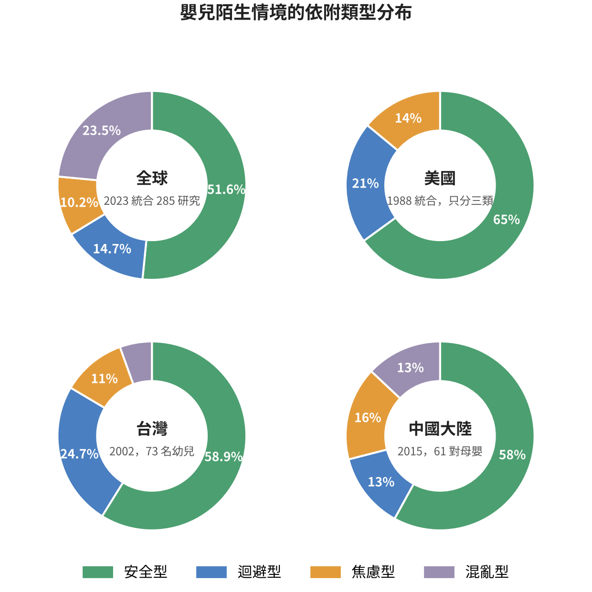
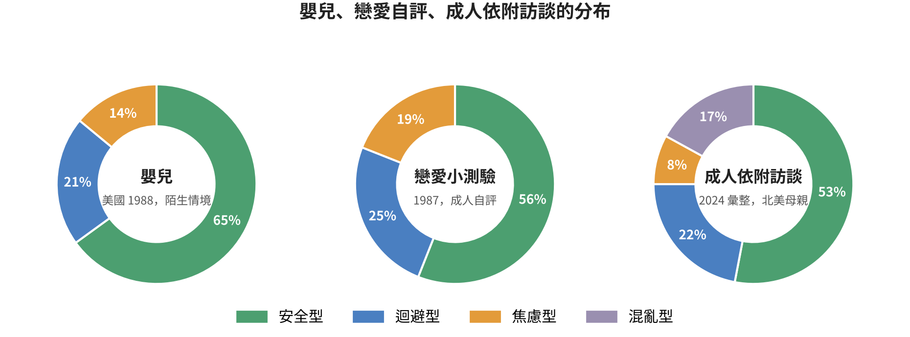

← [[精神分析 Psychoanalysis]]

> [!quote] 故事
> （以下改編自真實事件。）
>
> 1952 年的倫敦，一名兩歲半的小女孩住進醫院，準備動一個小手術。
>
> 當時英國的醫院嚴格限制父母探病：[有的醫院一週只開放一次](https://api.parliament.uk/historic-hansard/commons/1951/nov/15/hospital-visits)，[她住的醫院讓媽媽一天來一次，每次只能待一下子](https://doi.org/10.36854/widok/2020.26.2187)。
>
> 護理人員認為，媽媽來太多次只會讓孩子哭。
>
> 一名社工拿著攝影機，在固定的時間拍下她的樣子。
>
> 第一天，媽媽一轉身離開，她就哭喊著要媽媽。
>
> 過幾天，她很少哭，安靜地坐在床上，眼神漸漸空洞。
>
> 護理人員說：
>
> 「你看，她適應得很好。」
>
> 攝影機拍到的卻是另一件事：
>
> 她沒有適應，她只是不再表達情緒。
>
> 八天後，她出院回家。
>
> 這支黑白紀錄片，後來改變整個英國醫院對待小病人的方式。

這名小女孩叫 Laura，影片是社工 James Robertson 拍的《兩歲小孩住院》（A Two-Year-Old Goes to Hospital）。

他的合作者是英國精神科醫師鮑比（John Bowlby）。

Robertson 觀察過許多和父母分開的幼兒，把他們的反應分成三個階段：

1. 抗議（protest）：哭喊、找媽媽、拒絕別人安撫。
2. 絕望（despair）：安靜下來、退縮、對周圍失去興趣。大人常把這個階段誤認成「適應」。
3. 疏離（detachment）：分開更久時，孩子表面上恢復正常，父母回來時卻冷淡以對，像是把對父母的感情關上。

Laura 的影片記錄的是前兩個階段。

鮑比從這些觀察出發，提出一個問題：

孩子和照顧者之間，到底是什麼綁得這麼緊密，緊密到分開幾天就讓孩子崩潰？

他的答案，就是依附（attachment）。

<small>attachment 也譯作依戀。本站用依附，跟隨台灣譯本<a href="https://www.eslite.com/product/1001271512847603">鮑比《依戀理論三部曲》第一部《依附》</a>的譯法；而且 attachment 不只發生在戀愛裡，依靠、附著的「依附」比較通用。</small>

## 從精神分析到依附理論

鮑比是受過精神分析訓練的醫師，但他不滿意當時的正統解釋。

兩種主流理論都認為，孩子愛媽媽是因為媽媽餵飽他：

- 精神分析：孩子的愛來自[[性心理發展階段|口腔期]]的滿足。
- 行為主義：媽媽和食物一起出現，孩子學會喜歡媽媽，是一種二級增強。

鮑比一步步推翻這兩個主流觀點，發展出他的理論。

### 早年和媽媽分開，孩子可能不再親近人

鮑比在倫敦一間兒童輔導診所，比較 44 名有偷竊問題的孩子和 44 名沒有偷竊的孩子。

- 44 名小偷裡，有 14 名「無情型」的孩子，對人表面友善，內心卻很少和人建立感情。
- 14 名無情型的孩子之中，有 12 名在五歲以前和媽媽分開超過六個月。
- 對照組裡沒有無情型的孩子。

這個研究只是相關，不能證明分離造成偷竊的因果關係，但它讓鮑比開始追問「早年分離」如何影響個體。

### 孩子需要一位溫暖、持續的照顧者

二戰後，歐洲有大量孤兒和流離兒童。

世界衛生組織請鮑比整理研究，寫成《母親照顧與心理健康》。

他在報告裡主張：

> 嬰幼兒需要一位溫暖、親密、持續的照顧者，機構照顧再好也替代不了。

這份報告影響很大，但也有人拿它反對媽媽外出工作，是鮑比最受批評的地方。

### 小猴子要的是溫暖

美國心理學家 Harry Harlow 在一項[研究](https://doi.org/10.1037/h0047884)裡，讓剛出生的恆河猴在兩個假媽媽之間選擇：

- 硬邦邦的鐵絲製成，但掛著奶瓶的鐵絲媽媽。
- 包著柔軟的布，但沒有營養奶水的絨布媽媽。

雖然俗話說：「有奶便是娘。」然而，小猴子沒有因為鐵絲媽媽有奶，就只愛鐵絲媽媽。

只有餓的時候，小猴子才會去鐵絲媽媽那裡吃奶，其他時間都緊緊抱著絨布媽媽，害怕時也跑向布媽媽，而非有奶的鐵絲媽媽。

Harlow 把這份力量叫做接觸安慰（contact comfort）。

愛不是吃飽的附帶品，而是一種獨立的需求。

### 依附是演化留下的求生系統

鮑比把動物行為學、演化論和控制系統理論放進來，在 1969、1973、1980 年出版《依附》、《分離》和《失落》三部曲。

他的主張是：

> 依附是演化遺留的行為系統（attachment behavioral system）。

嬰兒天生就會哭、笑、跟隨、抱緊，目的是讓照顧者留在身邊，提高存活的機會。

依附系統就像會自動調節的變頻冷氣：

感到危險或和照顧者距離遙遠時啟動，重新感到安全時關閉。

## 依附是孩子和特定照顧者的情感連結

依附是孩子和特定照顧者之間，持久而有選擇性的情感連結。這種照顧者叫做「依附對象」（attachment figure）。

### 四種功能，決定一段關係算不算依附

一段關係算不算依附，看它有沒有這四種功能：

- 維持親近（proximity maintenance）：想待在依附對象身邊。
- 避風港（safe haven）：害怕、受傷或難過時，跑回依附對象身邊尋求安撫。
- 安全堡壘（secure base）：有依附對象在，才敢放心去探索世界。
- 分離苦惱（separation distress）：和依附對象分開時感到痛苦。

#### 害怕時回來，安心時出去

避風港和安全堡壘是同一個人的兩種功能，差別在於孩子往哪個方向走：

|  | 避風港 | 安全堡壘 |
|---|---|---|
| 什麼時候需要 | 害怕、受傷、難過時 | 安心、想探索時 |
| 孩子往哪裡走 | 回到照顧者身邊 | 離開照顧者，去探索世界 |
| 啟動的系統 | 依附系統 | 探索系統 |
| 照顧者要做的事 | 歡迎、安撫 | 放手、支持、在背後守著 |
| 例子 | 跌倒後哭著跑回媽媽懷裡 | 在公園越跑越遠，偶爾回頭確認媽媽還在 |

孩子整天在兩者之間來回：安心就出去，害怕就回來。依附系統和探索系統像蹺蹺板，一邊升高，另一邊就降低。後面諮商那段提到的「安全圈」，畫的就是這個來回。

### 依附在兩歲前一步步成形

鮑比描述依附在生命前幾年的發展。

1. 前依附期：出生到約 6 週。嬰兒用哭鬧、注視、抓握，吸引身邊的任何人叫到身邊，且不挑對象。
2. 依附形成期：約 6 週到 6–8 個月。開始偏好熟悉的人，但還能接受陌生人照顧。
3. 明確依附期：約 6–8 個月到 18–24 個月。把照顧者當成安全堡壘，出現分離焦慮和怕生。
4. 目標修正的夥伴關係：約兩歲以後。孩子能理解父母也有自己的計畫，可以和父母商量「媽媽什麼時候回來」。

Laura 兩歲半，正好在第三階段「明確依附期」的尾聲左右：

她已經深深依附媽媽，卻還不太能用語言理解「媽媽明天會來」。

#### 四套發展理論，看的是同一段童年

如果把鮑比的依附四階段，和[[客體關係理論 Object Relations Theory|克萊恩]]、佛洛伊德的[[性心理發展階段|性心理發展]]、艾瑞克森的心理社會發展互相比較，可以看出這些發展階段理論的異同之處：

| 年齡 | 鮑比：依附 | 克萊恩：客體關係 | 佛洛伊德：性心理 | 艾瑞克森：心理社會 |
|---|---|---|---|---|
| 0–6 週 | 前依附期 | 偏執－分裂心位（0–3、4 個月） | 口腔期（0–1.5 歲） | 信任對不信任（0–1.5 歲） |
| 6 週–6、8 個月 | 依附形成期 | 憂鬱心位（約 4–6 個月起） | 口腔期 | 信任對不信任 |
| 6、8 個月–1.5、2 歲 | 明確依附期 | 早期伊底帕斯情結（第一年後半起，與憂鬱心位一起開始） | 口腔期，接著進入肛門期（1.5–3 歲） | 接著進入自主對羞愧懷疑（1.5–3 歲） |
| 2 歲以後 | 目標修正的夥伴關係 | 兩個心位一生來回擺盪 | 肛門期，接著進入性蕾期（3–6 歲） | 自主對羞愧懷疑，接著進入主動對罪惡感（3–6 歲） |

四套理論看的是同一段童年，關心的東西很不一樣：

|  | 鮑比 | 克萊恩 | 佛洛伊德 | 艾瑞克森 |
|---|---|---|---|---|
| 發展的動力 | 演化來的依附系統，追求安全 | 生本能和死本能帶來的焦慮與幻想 | 性本能 | 生理成熟加上社會的要求 |
| 關注什麼 | 和照顧者的真實互動 | 內在客體與幻想 | 快感來源與衝突 | 每個階段的心理社會危機 |
| 涵蓋的年紀 | 前幾年發展完成，依附終身運作 | 第一年為主 | 出生到青春期 | 一生八個階段 |
| 是不是一階一階 | 是，循序發展 | 不是，心位是一生來回的狀態 | 是，可能在某階段固著 | 是，但危機可以在後來重新處理 |
| 證據來源 | 觀察、實驗、追蹤研究 | 兒童分析的臨床觀察 | 成人分析的回溯 | 臨床觀察和跨文化田野 |

### 童年互動變成一張人際地圖

孩子和依附對象一次次互動，會在心裡建立兩個問題的答案。

鮑比把這些答案叫做內在運作模式（internal working model）：

- 關於別人：我需要幫忙時，重要的人會不會來？
- 關於自己：我是不是一個值得被照顧、被愛的人？

內在運作模式就像一張人際關係的地圖。

長大後，人會帶著這張地圖去預測伴侶、朋友、同事或治療師會怎麼對待自己。

這個概念和[[客體關係理論 Object Relations Theory|客體關係理論]]的「內在客體」很像。

差別在於，「內在運作模式」的理論依據來自真實發生過的互動，而且可以用實驗和追蹤研究檢驗。

### 孩子能夠同時依附好幾個人

大多數孩子在兩歲前就會對好幾個人產生依附，例如媽媽、爸爸、祖父母或保母。

這些依附對象有優先順序，孩子最不舒服時，會先找排在最前面的那一位。

排第一的人不一定是媽媽，而是提供最多照顧和互動的人。

## Ainsworth 用陌生情境測量依附

鮑比雖然是依附理論的奠基者，但是讓理論可以量化研究的功臣，是他的同事安斯沃斯（Mary Ainsworth）。

- 1950 年代，她在烏干達的村莊觀察母親和嬰兒。
- 回到美國後，她在巴爾的摩長期到家庭裡觀察，記錄嬰兒一歲以前和母親的互動。
- 為在實驗室裡重現孩子害怕時怎麼找媽媽，她設計出陌生情境（Strange Situation）。

1978 年，Ainsworth、Blehar、Waters 和 Wall 合著的[書](https://doi.org/10.4324/9780203758045)，把陌生情境的流程和分類方式正式寫下來。

陌生情境至今仍是測量嬰兒依附的標準。

### 八個片段，關鍵在重聚階段

陌生情境約 20 分鐘，分成八個片段，每段大約三分鐘。

嬰兒多半是一歲左右。

1. 媽媽和嬰兒進入一間陌生的遊戲室。
2. 媽媽坐著，嬰兒自由玩玩具。
3. 一位陌生人進來，先安靜坐著，再和媽媽聊天，最後接近嬰兒。
4. 媽媽離開，留下嬰兒和陌生人。這是第一次分離。
5. 媽媽回來，陌生人離開。這是第一次重聚。
6. 媽媽再次離開，嬰兒獨自留在房間。
7. 陌生人進來安撫嬰兒。
8. 媽媽回來。這是第二次重聚。

嬰兒哭得太厲害時，研究者會縮短分離的片段。

判斷依附類型，重點不在嬰兒分離時哭不哭，而在重聚時怎麼對待媽媽。

### 四種面對害怕的策略

Ainsworth 一開始提出三種類型，用字母 A、B、C 命名。後來 Mary Main 和 Judith Solomon 在 1986 和 1990 年加上第四種 D 型。

#### B 型：安全型依附（secure）

<small>其他譯名：安全依附、安全依戀。</small>

- 在陌生情境：媽媽在場時能夠放心探索，分離時可能哭，但重聚時會主動找媽媽，很快就恢復情緒，又回去探索和玩耍。
- 照顧者的樣子：敏感、一致，能讀懂孩子的訊號並及時回應。
- 孩子學到：我需要的時候，有人會來。

#### A 型：迴避型依附（avoidant）

<small>其他譯名：逃避型、焦慮逃避型。成人依附研究裡也譯作排除型、疏離型、漠視型。</small>

- 陌生情境：分離時看起來不太在乎，重聚時轉開頭、不找媽媽，繼續玩玩具。
- 孩子的態度：表面的冷靜是一層面具，1977 年 Sroufe 和 Waters 的心跳研究發現，這些嬰兒的身體一樣處在壓力狀態。
- 照顧者的態度：他們的照顧者回應孩子依附需求的方式，常常拒絕或不耐煩。
- 孩子的主觀經驗：表達我自身的需求，照顧者只會推開我，不如自立自強。

#### C 型：焦慮型依附（resistant / ambivalent）

<small>其他譯名：抗拒型、矛盾型、焦慮矛盾型、焦慮抗拒型。成人依附研究裡也譯作糾結型、專注型、迷戀型。</small>

- 陌生情境：媽媽在身邊時就不太敢探索，分離時非常痛苦，重聚時一邊要媽媽抱，一邊生氣推開她，很難被安撫。
- 照顧者的態度：時好時壞。有時很投入，有時又不在場。
- 孩子的主觀經驗：誇大需求，抓緊一點，說不定就有機會得到回應，否則照顧者又要離開我了。

#### D 型：混亂型依附（disorganized / disoriented）

<small>其他譯名：紊亂型、解組型。成人依附訪談裡對應的類型也譯作未解決型。</small>

- 陌生情境：出現矛盾或奇怪的行為，例如朝媽媽走去卻把臉轉開，突然僵住不動，眼神放空。
- 照顧者的態度：常常自己害怕或讓孩子害怕，例如受創傷未解的父母或虐待的照顧者。
- 孩子的困境：提供安全感的人，同時又是恐懼的來源。Main 把這個困境稱為「沒有解法的恐懼」。

A、B、C 三型各自是一套有組織的策略：

| 類型 | 害怕時的策略 | 重聚時的樣子 | 照顧者的態度 | 孩子心裡的話 |
|---|---|---|---|---|
| 安全型 | 直接尋求安撫 | 主動找媽媽，很快恢復，又回去玩 | 敏感、一致 | 我需要的時候，有人會來 |
| 迴避型 | 壓低需求 | 轉開頭、不找媽媽 | 常常拒絕或不耐煩 | 不如自立自強 |
| 焦慮型 | 放大需求 | 一邊要抱、一邊生氣推開，很難安撫 | 時好時壞 | 抓緊一點，才不會被丟下 |
| 混亂型 | 無所適從，策略崩解 | 矛盾、僵住、眼神放空 | 自己害怕或讓孩子害怕 | 保護我的人，也是我害怕的人 |

### 全球約一半的嬰兒是安全型

不同年代的統計數字不同，因為後來加入 D 型，樣本也從中產階級擴大到高風險家庭。

- 只分三類的年代：van IJzendoorn 和 Kroonenberg 在 1988 年的[統合分析](https://doi.org/10.2307/1130396)彙整 8 個國家、32 個樣本、約 2,000 名嬰兒。其中 18 個美國樣本的平均是安全 65%、迴避 21%、焦慮 14%。
- 加入混亂型之後：2023 年 Madigan 等人的[統合分析](https://doi.org/10.1037/bul0000388)彙整 285 個研究、20,720 對親子，全球分布是安全 51.6%、迴避 14.7%、焦慮 10.2%、混亂 23.5%。

Madigan 的統合也發現，社會經濟風險越高的族群，迴避和混亂型越多；父母有精神疾病、孩子受虐時，混亂型也越多。

### 同一文化內的差異，比文化之間還大

1988 年的統合發現，每個國家都是安全型最多，但不安全的類型有地區差異：

- 西歐，例如德國：迴避型較多。一種解釋是當地父母更早鼓勵孩子獨立。
- 日本和以色列：焦慮型較多。一種解釋是當地嬰兒很少和媽媽分開，陌生情境對他們比較強烈。

更重要的是，同一個國家內部的差異，比國家之間的差異還大，約是 1.5 倍。所以不能用一個樣本代表整個文化。

### 華人樣本也以安全型最多

台灣和中國大陸也累積不少陌生情境和依附研究：

- 台灣第一個依附研究，是 1990 年蘇建文、丁心平和許錦雲用陌生情境觀察 62 名一歲嬰兒。
- 中山醫學大學王慶福在 2010 年[回顧](https://ir.csmu.edu.tw:8080/bitstream/310902500/14099/2/%E7%8E%8B%E6%85%B6%E7%A6%8F.pdf)台灣二十年來的依附研究，共 28 篇期刊論文、58 篇碩士論文和 10 篇博士論文，大部分結果支持或部分支持依附理論。
- 2002 年成大的一篇[碩士論文](https://thesis.lib.ncku.edu.tw/thesis/detail/90fcc133dadcc31b8802d68d7aa5fca9)觀察 73 名一般家庭的十四個月幼兒：安全型 58.9%、迴避型 24.7%、焦慮型 11%、混亂型 5.5%。
- 2015 年 Archer 等人在中國大陸的[研究](https://pure.uhi.ac.uk/en/publications/attachment-between-infants-and-mothers-in-china-strange-situation/)分類 61 對母嬰：安全型 58%、迴避型 13%、焦慮型 16%、混亂型 13%。研究者認為，焦慮型多於迴避型，符合重視相互依賴的文化。
- 2013 年 Posada 等人在九個國家，包括台灣，用依附 Q 分類在自然情境中觀察 547 名孩子。這份[研究](https://doi.org/10.1111/cdev.12084)發現，每個國家的孩子都把媽媽當成安全堡壘，各國專家描述的「最理想的安全孩子」也非常相似。

台灣和中國大陸的樣本，和全球一樣以安全型最多。

但不安全類型的比例，在不同研究之間差很多：台灣論文結果顯示迴避型較多，中國則是焦慮型較多。

正好呼應前面那句話：

> 同一個文化內部的差異，可能比文化之間的差異還大。

#### 依附理論適合台灣嗎？

把台灣和中國大陸的分布，放在前面的全球和美國數字旁邊：

| 樣本 | 安全型 | 迴避型 | 焦慮型 | 混亂型 |
|---|---|---|---|---|
| 全球，2023 年統合 285 個研究 | 51.6% | 14.7% | 10.2% | 23.5% |
| 美國，1988 年統合，只分三類 | 65% | 21% | 14% | 沒有分 |
| 台灣，2002 年 73 名十四個月幼兒 | 58.9% | 24.7% | 11% | 5.5% |
| 中國大陸，2015 年 61 對母嬰 | 58% | 13% | 16% | 13% |

和其他文化圈相同的地方：

- 安全型都是最多的一型。
- 九國研究裡，台灣孩子和其他國家一樣把媽媽當成安全堡壘。
- 1990 年台灣第一個研究發現，三種類型的比例和 Ainsworth 1978 年的美國樣本相似。

不同的地方：

- 1990 年這個研究也指出，台灣的分布和德國、以色列、日本不同；台灣 2002 年那篇的迴避型比全球高，和美國比較接近；中國大陸那篇是焦慮型多於迴避型，和日本、以色列相似。
- 台灣那篇的混亂型只有 5.5%，遠低於全球的 23.5%。但全球數字包含高風險和受虐樣本，台灣那篇是一般家庭，兩者不能直接比較。

所以，依附理論適不適合台灣？

- 理論的骨架適用：安全堡壘在不同文化都看得到，台灣大部分研究也支持或部分支持依附理論。
- 比例的問題還沒有答案：台灣只有少數小樣本的陌生情境研究，沒有大型的統合分析。王慶福的回顧也指出，國內研究很少深入探討文化差異。

上表的台灣數字，只能當成一個參考點，不能代表台灣。

### 照顧者的敏感度很重要，但不是唯一的條件

Ainsworth 認為，決定依附類型的關鍵，是照顧者的敏感度（sensitivity），即，照顧者能不能察覺孩子的訊號、正確理解它，並及時、適當地回應。

後來的研究支持這個看法，但敏感度只能解釋一部分的差異：

- 1997 年 De Wolff 和 van IJzendoorn 的[統合分析](https://doi.org/10.1111/j.1467-8624.1997.tb04218.x)發現，敏感度和依附安全有中等程度的關聯：敏感度很重要，但不是唯一的條件。
- 2003 年一份介入研究的[統合分析](https://doi.org/10.1037/0033-2909.129.2.195)發現，越能提高父母敏感度的介入，也越能提高孩子的依附安全。這支持敏感度影響依附的因果關係。
- 孩子的氣質、家庭壓力、父親的角色等，也各自影響依附。

## 長大後，依附仍在運作

鮑比認為，依附「從搖籃到墳墓」都在運作。

1980 年代，研究者開始研究成人的依附，後來分成兩條幾乎各走各的路：

- 發展心理學的路：用訪談測量「一個人怎麼談自己的父母」，關心的是親子之間的依附類型代際傳遞。
- 社會與人格心理學的路：用自陳問卷測量「一個人在戀愛裡怎麼感受和行動」，關心的是伴侶關係。

兩條路的工具測得的意義不同，彼此只有很弱的關聯，不能互相取代。

### 重要的不是童年發生什麼，而是怎麼談童年

1985 年，George、Kaplan 和 Main 發展出成人依附訪談。

- 訪談大約一小時，請受訪者用五個形容詞描述小時候和父母的關係，再為每個形容詞舉出具體的回憶。
- 訪談也問到分離、失落、被拒絕和創傷的經驗。
- 評分不看童年發生什麼事，而看受訪者現在說這些事的方式：有沒有矛盾、有沒有證據、通不通順。這叫做談話的連貫性（coherence）。

成人依附訪談把成人分成四類，對應嬰兒的四種類型：

- 安全型：對應 B 型。不管童年好不好，都能坦白、連貫地談，也重視依附關係。
- 迴避型：對應 A 型。說「我媽很好」卻舉不出實例，或說「我不記得，反正也沒影響」。
- 焦慮型：對應 C 型。一談到父母就陷進去，越說越氣，越說越雜。
- 混亂型：對應 D 型。談到失落或創傷時，說話突然出現混亂，例如：說到已過世的人像是還活著。這一類會疊加在其他三類之上。

2024 年一份彙整超過 26,000 份成人依附訪談的[研究](https://doi.org/10.1080/14616734.2024.2422045)，以北美一般、非高風險的母親為常模，分布約是安全 53%、迴避 22%、焦慮 8%、混亂 17%。男性比女性更常分到迴避型。

### 父母的依附會傳給下一代

成人依附訪談最驚人的發現，是父母怎麼談自己的童年，可以預測孩子的依附類型。

- 1995 年 van IJzendoorn 的[統合分析](https://doi.org/10.1037/0033-2909.117.3.387)，彙整 661 對親子：父母是安全或不安全，和孩子是安全或不安全，有 75% 是一致的。
- 1991 年 Fonagy 等人的[研究](https://doi.org/10.2307/1131141)發現，甚至在孩子還沒出生、媽媽還懷孕時做成人依附訪談，也能預測孩子一歲時的依附。
- 2016 年 Verhage 等人統整三十年研究的[新統合分析](https://doi.org/10.1037/bul0000038)仍然支持代際傳遞，但效果量比 1995 年小。

代際傳遞不是命中注定。

父母的敏感度只解釋一部分的傳遞，剩下的部分還不清楚是怎麼傳過去的，van IJzendoorn 把這個缺口叫做傳遞缺口（transmission gap）。

### 心智化：傳遞缺口的一塊拼圖

英國精神分析師 Peter Fonagy 提出的心智化（mentalization），是目前最受重視的補充說明。

> 心智化是用內在狀態理解行為的能力。如：看到一個行為，會去思考行為背後的想法、感受、需要和意圖。

例如寶寶一直哭，心智化好的媽媽會想「他是想肚子餓還是害怕？」而不是「這孩子到底在哭什麼意思的」。

心智化理論的重點有三個：

- 習得的心智化：孩子一直被照顧者當成「有心思的人」對待，聽到照顧者說出他的感受，慢慢才學會用心思理解自己和別人。
- 不完美的心智化：啟動壓力、害怕或依附系統等情緒激烈高漲的時候，人容易只看見表面的行為，或認定自己想的就是事實，沒辦法停下來反思不同可能。
- 研究裡用「反思功能」量表來測量心智化能力。

Luyten 和 Fonagy 在 2015 年的[回顧](https://doi.org/10.1037/per0000117)把心智化拆成四個向度，每個向度都有兩端：

| 向度 | 直覺 | 反思 |
|---|---|---|
| 自動與控制 | 以直覺快速讀懂別人 | 停下來有意識思考 |
| 自我與他人 | 理解自己的心思 | 理解別人的心思 |
| 內在與外在 | 推論看不見的想法和感受 | 從表情、動作等外在線索判斷 |
| 認知與情感 | 知道對方在想什麼 | 感受到對方的感受 |

心智化好的人，能視情境在「直覺」與「反思」之間兩端之間切換。

只停在某一端，例如：只看外在行為、或是只懂道理卻不帶情緒，都是心智化失衡。

- 1991 年 Fonagy 等人在孩子出生前，先用成人依附訪談訪問 100 位準媽媽和 100 位準爸爸，評估他們的反思功能，也就是談童年時，能不能用心理狀態理解自己和父母。這份[研究](https://doi.org/10.1002/1097-0355%28199123%2912:3%3C201::AID-IMHJ2280120307%3E3.0.CO;2-7)發現，父母的反思功能和孩子一歲時的依附安全顯著相關。
- 2005 年 Slade 等人追蹤 40 位媽媽，這份[研究](https://doi.org/10.1080/14616730500245880)發現，媽媽的成人依附和她對寶寶的反思功能有關，反思功能又和寶寶的依附有關。初步分析顯示，反思功能可能是依附從父母傳給孩子的重要路徑。
- 2017 年 Zeegers 等人的[統合分析](https://doi.org/10.1037/bul0000114)彙整近千名父母的資料，父母心智化和孩子依附安全的相關約 r = .30。

Fonagy 在 1994 年的[演講](https://doi.org/10.1111/j.1469-7610.1994.tb01160.x)中主張，反思功能是一種保護因子：童年辛苦、但能反思自己經驗的父母，比較不會把同樣的關係模式傳給下一代。

#### 心智化治療：情緒高漲時，練習把心智化接回來

Fonagy 和精神科醫師 Anthony Bateman 把心智化發展成心智化治療（Mentalization-Based Treatment），最早用在邊緣型人格障礙。

邊緣型人格障礙的核心困擾之一，是強烈的被拋棄恐懼。

依照心智化理論，情緒一旦高漲，心智化的能力就會斷線：對方晚回訊息，腦中只剩下「他不要我」的恐懼，想不到其他可能。

1999 年的[隨機對照試驗](https://doi.org/10.1176/ajp.156.10.1563)讓 38 名邊緣型人格障礙的個案，分別接受部分住院的心智化治療或一般精神科照護。

[八年追蹤](https://psychiatryonline.org/doi/10.1176/appi.focus.11.2.261)時，心智化治療組有自殺相關行為的比例是 23%，一般照護組是 74%。

### 戀愛也是一種依附

Cindy Hazan 和 Phillip Shaver 為一項[研究](https://doi.org/10.1037/0022-3514.52.3.511)，在報紙上刊登一份「愛情小測驗」，請讀者從三段描述裡選最像自己的一段。

- 安全型：我覺得和人親近並不難，依賴別人、讓別人依賴我都很自在。
- 迴避型：和人太親近會讓我不舒服，很難完全信任或依賴別人。
- 焦慮型：我常擔心伴侶不是真的愛我，是否隨時會離開我；我想和對方完全融合，但這種想法卻常常嚇跑對方。

結果有 56% 的人選安全型，其餘大約四分之一選迴避型、五分之一選焦慮型，和嬰兒研究的比例很接近。

Hazan 和 Shaver 因此主張：

> 成人的戀愛也是一種依附。伴侶取代父母，成為避風港和安全堡壘。

### 戀愛測驗和陌生情境，測的不是同一件事

Hazan 和 Shaver 的比例和嬰兒很接近，容易讓人以為兩者測的是同一種依附。其實它們在每個面向都不一樣：

|  | 陌生情境 | 戀愛測驗與親密關係問卷 |
|---|---|---|
| 測誰 | 一歲左右的嬰兒 | 成人 |
| 哪一段關係 | 孩子和照顧者 | 成人和伴侶 |
| 怎麼測 | 研究者觀察行為 | 自己填問卷 |
| 測到什麼 | 壓力下的依附行為策略 | 自己意識得到的感受、想法和擔心 |
| 結果的形式 | 四種類型 | 早期分三類，後來改成焦慮與迴避兩個向度 |
| 受不受自我認識影響 | 不受，嬰兒不會回答問題 | 會，只能測到自己察覺得到的部分 |

成人依附訪談夾在中間：受訪者是成人，談的卻是童年和父母；評的不是他說什麼，而是說得連不連貫。

2007 年 Roisman 等人的[統合分析](https://doi.org/10.1037/0022-3514.92.4.678)發現，成人依附訪談和戀愛問卷的關聯平均只有 r = .09，幾乎可以忽略。

所以，網路測驗說你是「焦慮型」，只代表你現在在戀愛裡很害怕被丟下，不代表你一歲時是焦慮型的嬰兒。

三種測量的比例看起來很像，但比例像，不代表測的是同一群人、同一件事。

### 迴避其實有兩種

Kim Bartholomew 在 1991 年的[研究](https://doi.org/10.1037/0022-3514.61.2.226)指出，迴避其實有兩種。

她用「對自己的看法」和「對別人的看法」兩個向度，分出四種類型：

- 安全型：我值得被愛，別人也可以信任。
- 焦慮型：我不夠好，但別人很重要，所以必須拚命抓住關係。
- 迴避型：我很好，不需要別人；獨立比親密重要。
- 恐懼迴避型：我不夠好，別人也不可靠；渴望親密又害怕受傷，所以不敢靠近。

恐懼迴避型也譯作恐懼型、害怕型。

網路上說的「混亂型」多半指這一型，但它是成人自評的戀愛類型，和嬰兒在陌生情境裡的混亂型不是同一種測量。

### 用焦慮和迴避兩個向度，比硬分類型更準

1998 年，Brennan、Clark 和 Shaver 把當時所有的成人依附問卷放在一起分析，發現它們其實都在測兩個彼此獨立的向度：

- 依附焦慮（attachment anxiety）：害怕被拒絕、被拋棄，需要對方一再保證自己被愛。
- 依附迴避（attachment avoidance）：對親密和依賴感到不自在，習慣保持距離。

他們用這兩個向度編出「親密關係經驗量表」（Experiences in Close Relationships, ECR）。當代研究普遍認為，成人依附最好用這兩個連續的向度來看，而不是硬分成類型。

兩個向度切出的四個區塊，正好對應 Bartholomew 的四類型：

|  | 依附迴避低 | 依附迴避高 |
|---|---|---|
| 依附焦慮低 | 安全型：我值得被愛，別人也可靠 | 迴避型：我很好，不需要別人 |
| 依附焦慮高 | 焦慮型：我不夠好，所以拚命抓住別人 | 恐懼迴避型：我不夠好，別人也不可靠 |

### 焦慮把警報開到最大，迴避把它關掉

Mikulincer 和 Shaver 把「依附焦慮」與「依附迴避」這兩個向度，看成兩種調節情緒的策略。

安全的人在害怕時直接找依附對象；當這個方法過去常常失敗，人就發展出兩種次級策略：

- 過度活化（hyperactivating）：依附焦慮高的人依附系統全開。不斷尋找愛和保證，對分離、背叛的跡象非常敏感。
- 關閉（deactivating）：依附迴避高的人壓抑依附系統。迴避自己需要別人這件事，強調莊敬自強。

不論是依附迴避還是依附焦慮，都是為少受一點傷的策略。

## 依附在身體裡留下的痕跡

鮑比說依附是演化留下的行為系統。

既然是演化的產物，身體裡應該找得到它的痕跡。

### 安全依附能緩衝壓力

皮質醇是身體面對壓力時分泌的荷爾蒙，可以從口水測量。

研究者用皮質醇濃度檢驗「是否不同依附類型的嬰兒，身體承受的壓力程度也會有所不同？」

- 1993 年 Spangler 和 Grossmann 的[研究](https://doi.org/10.2307/1131544)發現，安全型嬰兒經歷陌生情境後，皮質醇沒有上升；迴避型和混亂型則上升。
- 1995 年 Hertsgaard 等人在高風險家庭的[研究](https://doi.org/10.1111/j.1467-8624.1995.tb00925.x)也發現，混亂型幼兒的皮質醇比其他類型高。
- 迴避型的結果在不同研究之間並不一致；混亂型的皮質醇偏高，則是比較穩定的發現。

由此可知，安全依附有可能是應付壓力的緩衝墊之一。

1996 年 Nachmias 等人的[研究](https://experts.umn.edu/en/publications/behavioral-inhibition-and-stress-reactivity-the-moderating-role-o/)發現，天生膽小、容易退縮的幼兒面對新奇事物時，只有在依附不安全時皮質醇才會上升。

同樣膽小的孩子，有安全依附的話，身體比較不會警報大作。

### 牽手能夠安撫人心

成人的避風港，在大腦裡也看得見。

2006 年 Coan 等人的[研究](https://doi.org/10.1111/j.1467-9280.2006.01832.x)讓 16 位已婚女性躺在核磁共振機器裡，面對電擊的威脅，同時牽著先生的手、陌生研究人員的手，或不牽手。

- 牽伴侶的手時，大腦處理威脅的區域活化大幅下降。
- 牽陌生人的手，只下降一點。
- 婚姻品質越好，牽先生的手帶來的效果越大。

### 催產素真的是愛情荷爾蒙嗎？

2001 年 Insel 和 Young 的[回顧](https://doi.org/10.1038/35053579)指出，有一夫一妻行為的草原田鼠身上，催產素和抗利尿激素是形成伴侶關係的必要條件；沒有一夫一妻行為的山地田鼠身上，兩種荷爾蒙卻沒有明顯作用。

人類的證據就沒有這麼清楚。

研究人類時，研究者通常讓受試者從鼻孔噴入合成的催產素，再觀察信任、合作等行為。

使用鼻噴劑催產素而非口服或注射，是因為催產素是一種胜肽，口服會被消化掉，打進血液又很難穿過血腦障壁。不過，使用鼻噴劑之後到底有多少催產素能進入大腦，目前還有爭議。

2005 年 Kosfeld 等人在《自然》期刊發表[研究](https://doi.org/10.1038/nature03701)，發現噴了催產素的人在投資遊戲裡更信任別人。這篇研究讓催產素成為「信任荷爾蒙」。

但 2015 年 Nave 等人的[回顧](https://doi.org/10.1177/1745691615600138)指出，這個最受矚目的結果，後來重複驗證得並不好。

更全面地看，2016 年 Walum 等人的[分析](https://doi.org/10.1016/j.biopsych.2015.06.016)指出，這類研究普遍樣本太小、統計檢定力不足，結果很可能被高估，所以「催產素是愛的荷爾蒙」這種說法，目前證據還不夠。

## 哀悼是依附系統在找一個不會回來的人

鮑比三部曲的最後一部是《失落》。

他認為，哀悼就是依附系統在依附對象永久消失之後，仍然繼續運作：

> 人會尋找，等待和呼喚一位不歸者。

### 哀悼四階段

鮑比和精神科醫師 Colin Murray Parkes 描述成人哀悼的[四個階段](https://pmc.ncbi.nlm.nih.gov/articles/PMC1112778)：

1. 麻木：失落剛發生的幾小時到幾天，一切感覺不真實。
2. 渴求：強烈思念，會在人群中好像看到對方，或夢到對方還活著。
3. 混亂與絕望：開始接受對方真的不會回來，生活失去方向。
4. 重組：慢慢建立沒有對方的新生活。

這四個階段不是單純的線性歷程，人會在各種階段之間往返多次。

前兩個「麻木」和「渴求」階段和開場故事提到 Laura 的抗議和絕望很像。鮑比可能認為：

> 孩子和媽媽分開時的反應，和大人失去摯愛時的哀悼，背後是同一套依附系統。

### 不是每個人都會走完四個階段

後來的研究發現，哀傷的樣子比階段模型更多元。

- 2004 年 Bonanno 等人的[研究](https://doi.org/10.1037/0882-7974.19.2.260)追蹤喪偶的長者，從配偶過世前幾年一直追到過世後 18 個月。將近一半的人從頭到尾都很少憂鬱，思念等哀傷症狀也很輕。這不是壓抑，而是復原力。
- 約 10% 到 15% 的人，哀傷症狀長期持續、影響生活；依附焦慮高、依附不安全的人，比較容易落入這種狀態，這是 Mancini 和 Bonanno 在一份[研究](https://pmc.ncbi.nlm.nih.gov/articles/PMC3489169)裡整理的結果。
- 2022 年，美國精神醫學會在 DSM-5-TR 新增[延長哀傷障礙](https://www.psychiatry.org/File%20Library/Psychiatrists/Practice/DSM/DSM-5-TR/APA-DSM5TR-ProlongedGriefDisorder.pdf)：成人在親近的人過世至少 12 個月後，兒童和青少年至少 6 個月後，仍然強烈思念、反覆想著對方，造成明顯痛苦和功能損害。

成人依附訪談的混亂型，指的也是失落：談到過世的人時，說話突然變得混亂，好像他還沒有消化那份失落。

## 依附具有穩定性，但仍有改變的可能

如果童年的依附類型決定一輩子，諮商就沒有意義。

研究給出的答案是：依附有穩定性，但不是絕對穩定。

### 長期追蹤：多數人穩定，改變常伴隨重大變故

- 2000 年 Waters 等人的[縱貫研究](https://doi.org/10.1111/1467-8624.00176)追蹤 50 個人，從一歲的陌生情境一路追到二十歲左右的成人依附訪談。安全或不安全的分類，有 72% 的人前後一致。
- 同一個研究裡，改變類型的人，多半經歷過重大變故，例如：父母離婚、失去父母、父母重病或受虐。
- 也有其他縱貫研究找不到這麼高的依附類型穩定性，例如同年 Weinfield 等人追蹤[高風險家庭](https://doi.org/10.1111/1467-8624.00178)的研究。

### 間隔越久，依附越可能改變

- 2002 年 Fraley 的[統合分析](https://doi.org/10.1207/S15327957PSPR0602_03)發現，從嬰兒到十九歲的依附安全，穩定性是中等程度。他認為，早期的內在運作模式會留下一個「原型」，後來的經驗不斷修改它，但不會完全抹除。
- 2013 年 Pinquart 等人的[統合分析](https://doi.org/10.1080/14616734.2013.746257)彙整 127 篇研究、超過兩萬一千段依附關係，整體呈現中度穩定性，相關係數 = .39。
- 同一份統合也發現，兩次測量間隔越久，穩定性越低；間隔超過十五年時，穩定性已經不顯著。

也就是說，一歲的依附是一個起點。後來的關係、失落、創傷和修復，都會繼續改寫它。

### 習得性安全：辛苦的童年，也能長出安全的依附

有些人在成人依附訪談裡說出很辛苦的童年，例如父母冷漠、失控或不在身邊，但他們談的方式卻坦白而連貫，所以訪談把他們分為安全型。

研究者稱這種情況為習得性安全（earned security）。

- 1994 年 Pearson 等人的[研究](https://doi.org/10.1017/S0954579400004636)發現，習得性安全的父母對孩子的教養品質，和一直都是安全型的父母差不多。
- 這些人常常提到，成長過程中有一個替代的依附對象，例如：祖父母、老師、伴侶、前輩、同事、友人或是治療師。
- 2002 年 Roisman 等人用二十多年的[縱貫資料](https://doi.org/10.1111/1467-8624.00467)提醒：回頭自述童年辛苦的習得性安全者，嬰兒期並沒有比較常是不安全型，高風險樣本裡有些人小時候反而得到相當支持的照顧。回憶裡的童年，不一定等於當年發生的事，所以這個概念需要謹慎使用。

習得性安全對諮商來說很重要：成人依附訪談評分的是「現在怎麼說」，不是「當年發生什麼」。

過去沒辦法改變，但可以改變一個人如何理解和談論過去。

### 依附理論常見的六個誤解

依附理論很流行，也因此常常有人誤用它。

- 依附不是出生後的黃金幾小時：1970 年代有人主張，媽媽和新生兒在出生後馬上肌膚接觸，才能建立「連結」（bonding）。後來的研究沒有支持這個關鍵期的說法。依附是在第一年裡的無數次互動中慢慢建立的模式，不是鳥類的印痕。
- 依附理論不等於「親密育兒法」（attachment parenting）：親密育兒法主張全母乳、同睡、隨時揹著嬰兒，這些做法不是依附研究的結論。依附研究關心的是敏感度，不是特定的育兒方法。如同溫尼考特所說：「只需要夠好的母親，不需要完美的母親。」
- 不安全型依附不等於有病：約一半的人是不安全型，這是一種習得的適應策略，不屬於任何精神疾病診斷項目。
- 混亂型不能用來判定受虐：2017 年 Granqvist 等多位依附學者的[共識聲明](https://doi.org/10.1080/14616734.2017.1354040)指出，混亂型和兒童受虐有關，但很多混亂型的孩子並沒有受虐，所以不能當成法庭或兒少案件的判決證據。
- 不安全依附不等於依附障礙：反應性依附障礙（Reactive Attachment Disorder）是 DSM-5 的診斷，幾乎只出現在嚴重忽視的孩子身上，例如在機構長大、沒有固定照顧者的孩子。
- 網路上的「你是哪一型」測驗，測的是成人戀愛的焦慮和迴避傾向，不是你一歲時的依附類型，也不是成人依附訪談的結果。

## 依附理論看重真實經驗，而不是幻想

依附理論從精神分析出發，卻走出一條不同的路。

### 一位母親住院，讓鮑比走上和克萊恩不同的路

鮑比受訓時，督導是客體關係理論的克萊恩。

他的第一個兒童個案是一個三歲左右的男孩，治療三四個月後，男孩的媽媽住進精神病院，這段經過記錄在鮑比的[演講逐字稿](https://pmc.ncbi.nlm.nih.gov/articles/PMC6287705)。

讓鮑比印象深刻的，是克萊恩幾乎不關心媽媽生病如何影響孩子，只專注在兒童的幻想。

精神科醫師 Jeremy Holmes 在[回顧](https://doi.org/10.1192/bjp.163.4.430)鮑比的生平時，指出克萊恩只關注兒童幻想，而非親子照顧經驗的行為，影響鮑比之後的研究焦點，也成為兩種理論分歧的起點：

[[客體關係理論 Object Relations Theory|客體關係理論]]重視孩子內心的幻想，依附理論重視真實發生的經驗。

### 三種理論都看重關係，但關係給的東西不同

[[客體關係理論 Object Relations Theory|客體關係]]、[[自體心理學 Self Psychology|自體心理學]]和依附理論，都認為早年關係塑造人格，也都把治療關係當成改變發生的地方。

差別在於，它們認為關係提供的東西不一樣：

|  | 客體關係理論 | 自體心理學 | 依附理論 |
|---|---|---|---|
| 關係裡的對方 | 內在客體：心裡混合真實和幻想的他人形象 | 自體客體：提供鏡映、理想化、孿生經驗的人 | 依附對象：害怕時能投靠的人 |
| 關係提供什麼 | 容納愛、恨、嫉羨等強烈情感 | 自我的完整和自尊 | 安全感，調節恐懼和不安 |
| 重視真實還是幻想 | 幻想 | 真實的回應和失誤 | 真實發生的經驗 |
| 研究方法 | 臨床觀察 | 臨床觀察 | 實驗、訪談、縱貫研究 |

研究方法也不一樣。

客體關係和自體心理學主要來自治療室裡的臨床觀察；依附理論則有陌生情境、成人依附訪談和縱貫研究，可以用實驗檢驗。

兩條路後來又慢慢靠近。

前面提到的 Fonagy 本身是精神分析師，他用依附研究的方法，回答精神分析關心的內在世界，連結精神分析與依附理論。

## 依附理論是諮商的工具之一

既然依附可以改變，治療關係就可以成為改變發生的地方。

依附理論本身不是一個治療學派，不過它確實是一套理解人際關係互動模式的框架，很多學派都用來輔助諮商。

### 治療師是安全堡壘

1988 年，鮑比在《安全堡壘》（A Secure Base）裡提出治療師的五個任務：

1. 提供一個安全堡壘，讓個案可以從這裡出發，去探索痛苦的經驗。個人中心取向提出的治療同盟，與依附理論的安全堡壘有異曲同工之妙。
2. 陪個案看他現在的關係：他對人有什麼期待，又怎麼在不知不覺中產生自己不想要的結果。
3. 看個案和治療師之間的關係，因為個案會把自己的運作模式帶進治療室。
4. 幫個案看見，現在的感受和期待是小時候和父母相處的結果。
5. 幫個案發現，這些舊的模式不一定適合現在的生活，進而想像並嘗試新的方式。

第三個任務和精神分析的[[移情與反移情 Transference and Countertransference|移情]]很像。

不同的是，鮑比認為個案帶進來的，是真實經驗形成的期待，不是幻想。

### 個案的依附影響治療

個案的依附風格會影響他怎麼使用治療：

- 安全的個案：比較容易建立治療同盟，治療效果也常常比較好。
- 依附焦慮高的個案：很快投入，但對治療師的小小疏忽非常敏感，請假、結案、晚回訊息都可能引發被拋棄的感受。
- 依附迴避高的個案：談事件很仔細，談感受很簡短，常說「還好」、「沒什麼」，也容易在關係變得親近時退後或中斷治療。

2018 年 Levy 等人彙整 36 個研究、3,158 名個案的[統合分析](https://doi.org/10.1002/jclp.22685)發現，治療前依附越安全的個案，治療結果越好；治療中依附變得更安全，結果也常常跟著變好。

同一份統合的初步分析也發現，依附不安全的個案，在聚焦人際互動和親密關係的治療裡，可能得到比較好的效果。

### 治療師要反著個案的策略走

1994 年 Dozier 等人的[研究](https://doi.org/10.1037/0022-006X.62.4.793)發現，治療師自己的依附也會影響治療：

安全的治療師比較能「反著個案的策略」工作，不安全的治療師則容易順著個案走。

- 對依附焦慮高的個案：治療師提供穩定、可預測的框架，安定洶湧的情緒和語言，學著在不確定中安撫自己。
- 對依附迴避高的個案：治療師溫和靠近情緒，陪他留意「沒什麼」底下的需求，不要跟著他只談事件。

兩種個案的方向相反，但目標一樣：

讓個案在治療室裡經驗到，需要別人的時候，不必把音量開好開滿，也不必刻意調成靜音。

### 依附取向的介入：看見情緒底下的需要

依附理論誕生出幾種有實證支持的介入：

- 「少即是多」：2003 年 Bakermans-Kranenburg、van IJzendoorn 和 Juffer 的[統合分析](https://doi.org/10.1037/0033-2909.129.2.195)發現，提高父母敏感度的介入平均具有中等效果量 d = 0.33。簡短、聚焦在敏感行為上的介入，比長期、廣泛的介入更有效。
- VIPP-SD：同一個荷蘭團隊發展的影片回饋介入。治療師拍下父母和孩子的日常互動，再和父母一起看，指出孩子的訊號和父母做得好的地方。
- 安全圈（Circle of Security）：用一張圈圈圖教父母，孩子有時需要父母當安全堡壘，支持他出去探索；有時需要父母當避風港，歡迎他回來。
- 情緒取向伴侶治療（Emotionally Focused Therapy）：Sue Johnson 套用依附理論於伴侶治療。伴侶吵架常常是一個追、一個逃的循環：追的人抓狂後面，是「你會不會離開？」的恐懼；逃的人的沉默後面，是「我怎麼做都不對」的恐懼。治療師幫兩個人看見循環、說出抓狂和沉默底下的依附需要，讓對方有機會回應。

這些介入的共同點，是不只討論想法，而是幫人看見情緒後面的依附需要，再找到更有效的方式去滿足它。

## 總結

- 依附是一套天生的行為系統：害怕時靠近照顧者，安心後再出去探索。
- 陪伴和照顧是依附的來源，食物不是。
- 陌生情境看重聚，不看分離：安全型直接求安撫，迴避型壓低需求，焦慮型放大需求，混亂型的策略崩解。
- 全球約一半的嬰兒是安全型，混亂型在高風險家庭裡特別多。
- 同一個文化內部的差異，常常比文化之間的差異還大，台灣和中國大陸的研究也是如此。
- 敏感度影響依附，但只是其中一個因素。
- 成人依附訪談看一個人怎麼談童年，戀愛問卷看焦慮和迴避兩個向度，兩者不能互相取代。
- 父母的依附會傳給孩子，心智化補上一部分傳遞缺口。
- 安全依附能緩衝壓力荷爾蒙，伴侶牽手也能降低大腦的威脅反應。
- 哀悼是依附系統在對象永久消失後繼續運作；多數人有復原力，少數人會陷入延長哀傷。
- 依附中等穩定，也可以改變，關係和治療都可能帶來習得性安全。
- 依附理論重視真實經驗和可檢驗的研究，這是它和客體關係、自體心理學最大的不同。
- 諮商師是個案的安全堡壘，對焦慮的個案穩住情緒，對迴避的個案靠近情緒。
